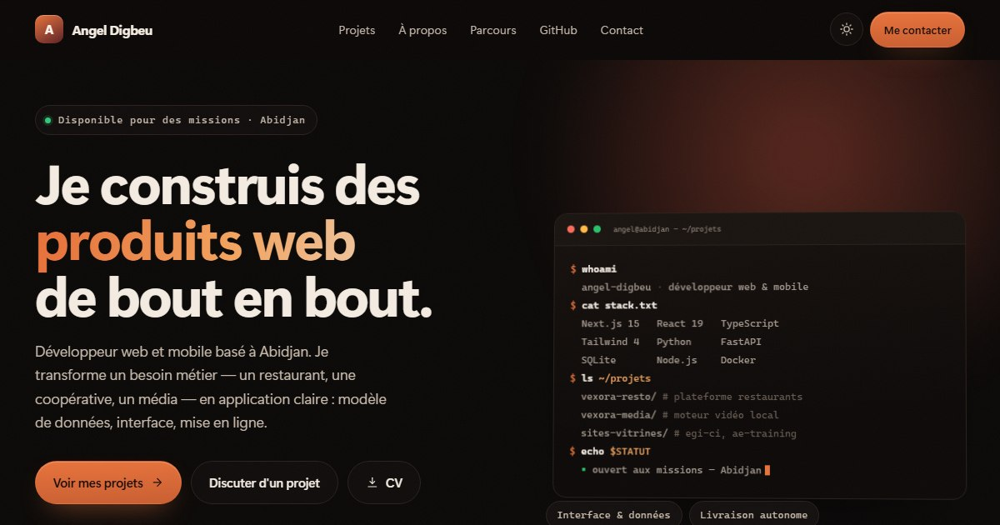
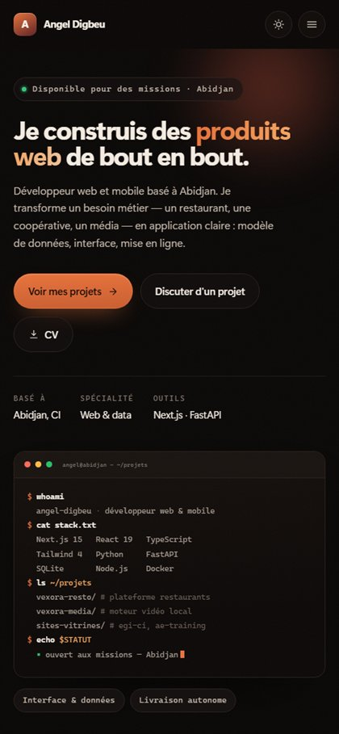

# Portfolio — Angel Ionel Digbeu

Site vitrine statique (HTML, CSS, JavaScript) sans aucune dépendance externe,
avec un script qui synchronise la liste des dépôts depuis GitHub.





---

## Lancer en local

Deux possibilités :

1. **Double-clic sur `index.html`** — tout fonctionne, y compris l'ouverture
   depuis le disque (`file://`), car le site n'effectue aucune requête réseau.
2. **Serveur local** (recommandé pour tester les liens et le cache) :

   ```powershell
   cd portfolio
   npm run serve        # http://127.0.0.1:5173
   ```

   `npm run serve` lance `tools/serve.mjs`, un serveur statique Node sans
   dépendance (port 5173 par défaut, modifiable : `node tools/serve.mjs 8080`).

---

## Administration (backend)

Tout le contenu du site se modifie depuis le navigateur, **sans toucher au code** :
textes, projets, parcours, liens, SEO, images, CV, dépôts GitHub.

```powershell
npm run password     # une seule fois : choisir le mot de passe admin (10 caractères min.)
npm run admin        # site : http://127.0.0.1:5174   admin : http://127.0.0.1:5174/admin/
```

Onglets de l'admin : Général & SEO · Accueil · Technologies · Projets · À propos ·
Parcours · GitHub · Contact & pied de page · Médias · Sauvegardes · Compte.

- **Enregistrer et publier** valide les données, sauvegarde l'ancienne version puis
  régénère `index.html`. Le site public reste du HTML statique, rapide, sans JavaScript serveur.
- **Aperçu** : visualiser les changements avant de publier.
- **Médias** : envoi d'images (JPG, PNG, WebP, SVG) et du CV (PDF), vérifiés sur leur contenu réel.
- **Sauvegardes** : les 60 dernières versions sont conservées, restauration en un clic.
- **GitHub** : bouton « Importer depuis GitHub » (remplace `npm run sync`, qui est désormais bloqué
  pour ne pas être écrasé).
- **Sécurité** : mot de passe haché (scrypt), session signée en cookie `HttpOnly`, 5 essais max
  par 15 min, protection CSRF, contenu échappé, CSP stricte sur l'admin.
  Aucune dépendance npm.

Fichiers importants : `data/content.json` (source de vérité du contenu),
`data/backups/` (sauvegardes), `data/auth.json` et `data/secret.key` (secrets, ignorés par git).
`npm run render` régénère `index.html` depuis `data/content.json` sans lancer le serveur,
`npm test` lance les tests du backend.

### Mettre l'admin en ligne

Le backend est un serveur Node : **GitHub Pages ne peut pas l'héberger** (il ne sert que des
fichiers statiques). Utilisez un hébergeur Node ou Docker (Render, Railway, Fly.io, VPS…) :

1. Démarrer avec `node backend/server.mjs` (ou le `Dockerfile` fourni).
2. Variables : `HOST=0.0.0.0`, `TRUST_PROXY=1` (derrière HTTPS), `ADMIN_PASSWORD=...` (premier mot de passe).
3. Monter un **volume persistant** sur `DATA_DIR` (contenu, sauvegardes, mot de passe) et
   `UPLOADS_DIR` (fichiers envoyés), sinon les modifications disparaissent à chaque redéploiement.

Voir `.env.example` pour la liste complète. Toujours servir l'admin en HTTPS.

---

## Structure

```
portfolio/
  index.html                 page unique (5 sections + nav)
  assets/
    css/style.css            design complet (thèmes clair/sombre, responsive)
    js/main.js               thème, menu mobile, filtres, révélations, copie
    docs/cv.pdf              CV téléchargeable (bouton hero + contact)
    img/
      favicon.svg            monogramme
      vexora-dashboard.png   capture réelle de l'app Vexora Resto
      vexora-mobile.jpg      capture mobile
      ae-training.jpg        capture du site AE Training
      egi-ci.jpg             capture du site EGI-CI
      og-image.jpg           image de partage (1200 × 630)
      preview-mobile.jpg     aperçu mobile pour ce README
  backend/
    server.mjs               serveur + API d'administration (/admin/)
    admin/                   interface d'administration (HTML, CSS, JS)
    lib/                     authentification, stockage, rendu, médias, validation
    seed/content.default.json  contenu initial (identique au site d'origine)
    test/                    tests automatisés (npm test)
  data/
    content.json             contenu du site (source de vérité)
  tools/
    serve.mjs                serveur statique local
    set-password.mjs         définir le mot de passe admin
    render.mjs               régénérer index.html depuis le contenu
    sync-github.mjs          ancien script de synchro (remplacé par l'admin)
  Dockerfile, .env.example   déploiement
  package.json               scripts `serve`, `admin`, `password`, `render`, `test`
```

---

## Mettre à jour les dépôts GitHub

La section « Dépôts publics » est générée depuis l'API GitHub :

```powershell
npm run sync
```

Le script :

- lit `https://api.github.com/users/LionelD145/repos` ;
- ignore les forks et les dépôts archivés ;
- réécrit uniquement les blocs délimités dans `index.html` par
  `<!-- BEGIN:GITHUB-REPOS -->` … `<!-- END:GITHUB-REPOS -->` et
  `<!-- BEGIN:GITHUB-STATS -->` … `<!-- END:GITHUB-STATS -->` ;
- met à jour le compteur « Dépôts publics » de la section À propos.

Options :

```powershell
node tools/sync-github.mjs --user autre-compte
node tools/sync-github.mjs --forks        # inclure les forks
node tools/sync-github.mjs --archived     # inclure les archives
node tools/sync-github.mjs --dry          # afficher sans écrire
```

**Dépôts privés / quota plus large** — l'API publique est limitée à
60 requêtes par heure et ne voit que le public. Avec un jeton en lecture seule :

```powershell
$env:GITHUB_TOKEN = "ghp_..."   # fine-grained token, lecture seule, non stocké
npm run sync
```

Le jeton n'est jamais écrit dans le site ni dans ce dossier.

---

## Publier en ligne

**Option A — site « utilisateur » (le plus simple)**
Créer un dépôt nommé `lioneld145.github.io`, y pousser tout le contenu de
`portfolio/`, puis *Settings → Pages → Deploy from a branch → main / (root)*.
Le site est en ligne sur `https://lioneld145.github.io/`.

**Option B — dépôt `portfolio`**
Pousser le dossier, puis *Settings → Pages → main / (root)*.
Le site sort sur `https://lioneld145.github.io/portfolio/` : les chemins sont
tous relatifs, il n'y a rien à modifier.

**Option C — Vercel / Netlify**
Glisser-déposer le dossier ou connecter le dépôt ; aucun build n'est nécessaire
(aucune commande de build, dossier de sortie : `.`).

> Pense à ajuster `<link rel="canonical">` et `og:url` dans `index.html` si
> l'adresse finale diffère de `https://lioneld145.github.io/`.

---

## Personnaliser

| Quoi | Où |
| --- | --- |
| Couleurs, rayons, polices | variables `:root` en tête de `assets/css/style.css` |
| Nom affiché | `<title>`, `.brand__name`, `.id-card__name`, pied de page |
| Textes du hero | `section.hero` dans `index.html` |
| Projets | cartes `article.card` (section `#projets`) + compteurs des filtres |
| Projet à la une | bloc `article.featured` |
| Adresse e-mail | liens `mailto:` et attributs `data-copy` |
| CV téléchargeable | `assets/docs/cv.pdf` (boutons `download` dans le hero et le contact) |
| Liste GitHub | automatique via `npm run sync` |

---

## Ce qui reste à compléter

- **Photo de profil** : la carte d'identité affiche un monogramme « A » ;
  remplacer `.id-card__mark` par une image ronde si souhaité.
- **Liens de démonstration** pour Vexora Resto (code privé aujourd'hui).
- **Dépôts privés** : voir la section synchronisation (jeton requis).

---

## Notes techniques

- **Zéro dépendance** : pas de CDN, pas de police distante, pas d'étape de
  build. Le site fonctionne hors ligne.
- **Thème** : clair/sombre persisté en `localStorage`, initialisé avant le
  premier rendu (aucun flash), aligné sur la préférence système par défaut.
- **Accessibilité** : lien d'évitement, focus visible, contrastes vérifiés,
  `aria-*` sur les contrôles, respect de `prefers-reduced-motion`.
- **Performance** : ~330 Ko d'images au total, CSS et JS non bloquants,
  animations en `transform`/`opacity` uniquement.
- **SEO** : `lang="fr"`, description, Open Graph, favicon SVG.
